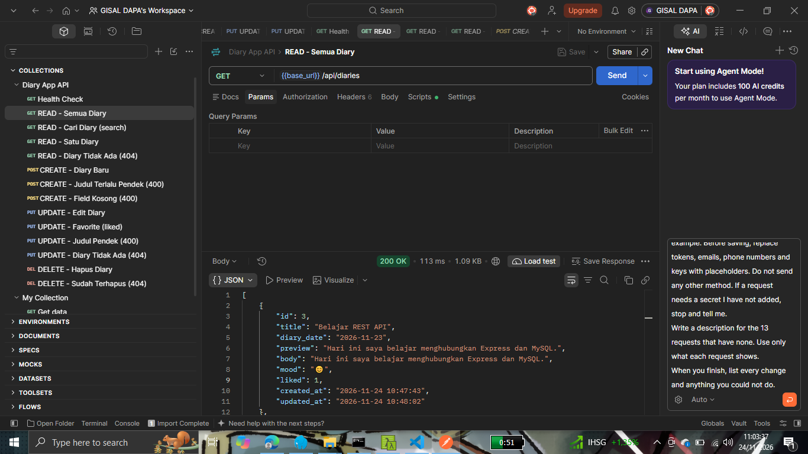
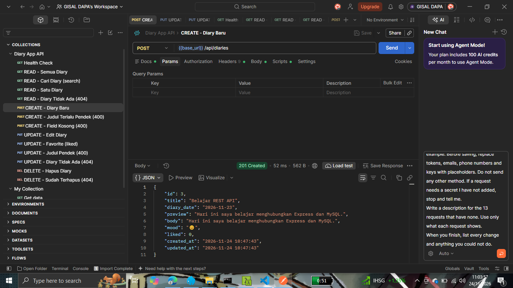
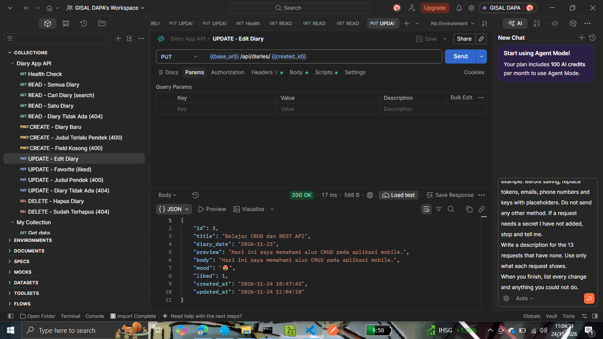
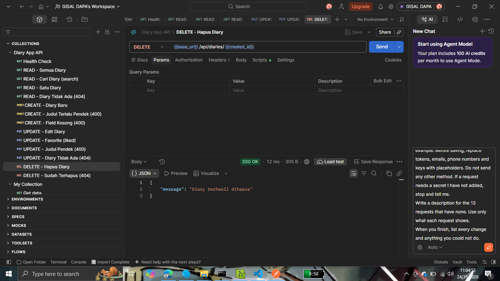
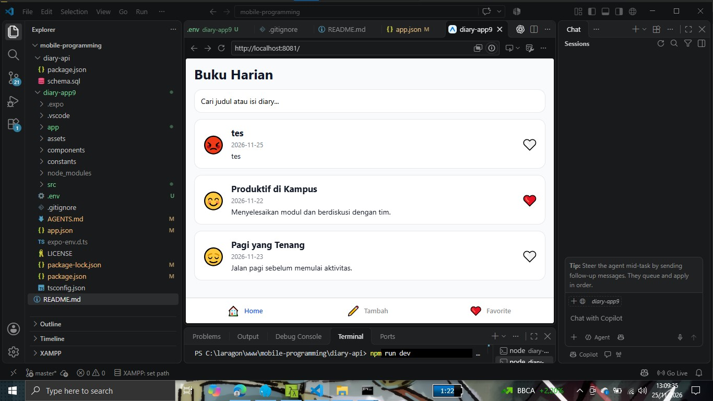
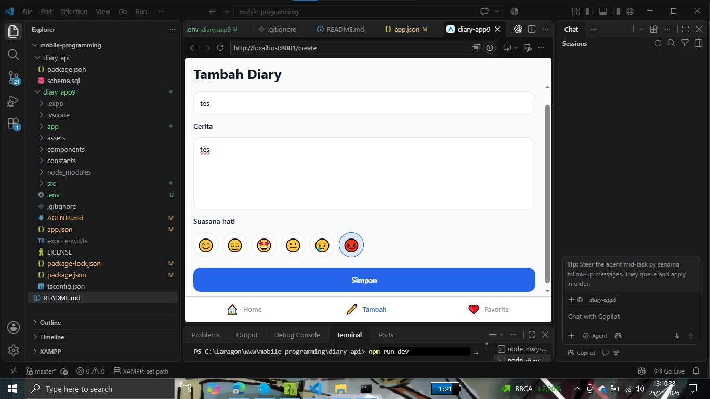
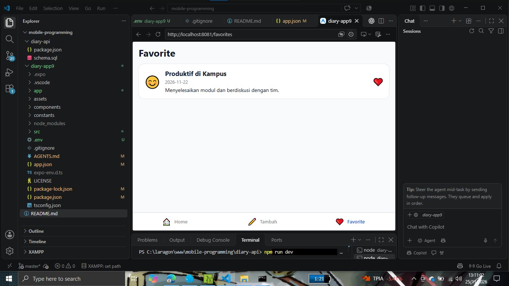

# Praktikum 9 — CRUD React Native dengan REST API (Diary App)

**CRUD pada React Native dengan REST API, Node.js, Express.js, dan MySQL**
Studi kasus: Diary App • Expo Router • Redux Toolkit • Postman

| | |
|---|---|
| **Nama** | Gisal Dapa |
| **NIM** | 2430511023 |
| **Kelas** | 5A |
| **Mata Kuliah** | Mobile Multi Platform |
| **Program Studi** | Teknik Informatika, Fakultas Sains dan Teknologi |
| **Universitas** | Universitas Muhammadiyah Sukabumi |

---

## 1. Gambaran Sistem

```
┌───────────────────────────┐
│   React Native + Expo     │
│   diary-app9              │
│   Redux Toolkit           │
└────────────┬──────────────┘
             │ HTTP + JSON (fetch)
             ▼
┌───────────────────────────┐
│   Node.js + Express.js    │
│   diary-api (REST API)    │
└────────────┬──────────────┘
             │ SQL (mysql2/promise)
             ▼
┌───────────────────────────┐
│   MySQL                   │
│   database: diary_app     │
│   table: diaries          │
└───────────────────────────┘
```

React Native tidak mengakses MySQL secara langsung. Aplikasi mobile berkomunikasi dengan REST API, lalu backend yang berkomunikasi dengan database.

| CRUD | HTTP | Endpoint | SQL |
|------|------|----------|-----|
| Create | POST | `/api/diaries` | INSERT |
| Read | GET | `/api/diaries`, `/api/diaries/:id` | SELECT |
| Update | PUT | `/api/diaries/:id` | UPDATE |
| Delete | DELETE | `/api/diaries/:id` | DELETE |

## 2. Struktur Proyek

```
mobile-programming/
├── diary-api/                      # Backend Node.js + Express + MySQL
│   ├── src/
│   │   ├── config/database.js
│   │   ├── controllers/diary.controller.js
│   │   ├── routes/diary.routes.js
│   │   └── server.js
│   ├── postman/Diary-App-API.postman_collection.json
│   ├── .env
│   ├── package.json
│   └── schema.sql
├── diary-app9/                     # Aplikasi mobile React Native (Expo Router)
│   ├── app/
│   │   ├── _layout.tsx
│   │   ├── (tabs)/                 # Home, Tambah, Favorite
│   │   ├── detail/[id].tsx
│   │   └── edit/[id].tsx
│   ├── src/
│   │   ├── store/                  # store.ts + hooks.ts (Redux)
│   │   ├── features/diary/         # diarySlice.ts
│   │   ├── services/               # diaryApi.ts (Fetch API)
│   │   ├── components/             # DiaryCard, DiaryForm, MoodPicker
│   │   ├── styles/                 # tokens.ts
│   │   └── utils/                  # date.ts
│   └── .env
├── ss/                             # Screenshot hasil praktikum
└── README.md
```

> Folder state Redux dinamai `src/store`, **bukan** `src/app`. Expo Router memakai `src/app` sebagai folder halaman apabila folder itu ada, sehingga halaman di `app/` tidak akan terbaca.

## 3. Cara Menjalankan

**Prasyarat:** Node.js versi 20 atau lebih baru, MySQL (Laragon/XAMPP), Postman, dan Expo Go atau browser.

### 3.1 Database

1. Jalankan MySQL (Laragon → **Start All**).
2. Jalankan `diary-api/schema.sql` sekali saja lewat HeidiSQL/phpMyAdmin, atau lewat terminal:
   ```bash
   mysql -u root -p --default-character-set=utf8mb4 < schema.sql
   ```
3. Pastikan database `diary_app` dengan tabel `diaries` terbentuk dan berisi 2 data awal.

### 3.2 Backend

```bash
cd diary-api
npm install
npm run dev
```

Sesuaikan `DB_USER` dan `DB_PASSWORD` pada `diary-api/.env` bila perlu. Jika berhasil, terminal menampilkan `Diary API berjalan pada port 3000`. Buka `http://localhost:3000/health` dan pastikan hasilnya `"database": "connected"`.

### 3.3 Aplikasi Mobile

```bash
cd diary-app9
npm install
```

Buat/isi file `diary-app9/.env`:

```
EXPO_PUBLIC_API_URL=http://localhost:3000
```

| Dijalankan di | Isi `EXPO_PUBLIC_API_URL` |
|---|---|
| Browser di laptop yang sama | `http://localhost:3000` |
| Android Emulator | `http://10.0.2.2:3000` |
| HP (Expo Go) | `http://<IPv4-laptop>:3000` (cek dengan `ipconfig`; HP dan laptop harus satu Wi-Fi) |

Lalu jalankan:

```bash
npx expo start -c
```

Variabel `EXPO_PUBLIC_*` hanya dibaca saat bundling, jadi setiap kali `.env` diubah, Expo harus dijalankan ulang dengan `-c`.

## 4. Endpoint REST API

| Method | URL | Keterangan |
|--------|-----|------------|
| GET | `/health` | Cek koneksi server ke database |
| GET | `/api/diaries` | Semua diary |
| GET | `/api/diaries?search=kata` | Cari pada `title` atau `body` |
| GET | `/api/diaries/:id` | Satu diary |
| POST | `/api/diaries` | Tambah diary (`title` minimal 3 karakter) |
| PUT | `/api/diaries/:id` | Ubah diary (parsial: `title`, `body`, `mood`, `liked`) |
| DELETE | `/api/diaries/:id` | Hapus diary |

| Status | Makna |
|--------|-------|
| 200 | Request berhasil (GET/PUT/DELETE) |
| 201 | Resource baru dibuat (POST) |
| 400 | Input tidak valid |
| 404 | Data tidak ditemukan |
| 500 | Kesalahan server atau database |

## 5. Pengujian dengan Postman

Impor `diary-api/postman/Diary-App-API.postman_collection.json` ke Postman (**Import**). Koleksi **Diary App API** berisi 14 request lengkap dengan test otomatis, termasuk skenario negatif (400 dan 404). Variabel `{{base_url}}` bernilai `http://localhost:3000` dan `{{created_id}}` menyimpan id dari request POST.

### 5.1 READ — `GET /api/diaries` → 200 OK



### 5.2 CREATE — `POST /api/diaries` → 201 Created



### 5.3 UPDATE — `PUT /api/diaries/:id` → 200 OK



### 5.4 DELETE — `DELETE /api/diaries/:id` → 200 OK



| Operasi | Request | Status diharapkan | Status hasil |
|---------|---------|:-----------------:|:------------:|
| READ | GET `/api/diaries` | 200 | 200 OK |
| CREATE | POST `/api/diaries` | 201 | 201 Created |
| UPDATE | PUT `/api/diaries/:id` | 200 | 200 OK |
| DELETE | DELETE `/api/diaries/:id` | 200 | 200 OK |

## 6. Tampilan Aplikasi

### 6.1 Home (READ)

Menampilkan diary dari MySQL, kolom pencarian, dan ikon hati untuk menandai favorit. Mendukung loading, error (tombol *Coba Lagi*), daftar kosong, dan tarik-untuk-muat-ulang.



### 6.2 Tambah (CREATE)

Form judul, cerita, dan pilihan suasana hati. Judul minimal 3 karakter; tombol dinonaktifkan selama request berjalan.



### 6.3 Favorite

Hanya menampilkan diary dengan `liked = true`. Status favorit disimpan ke MySQL lewat `PUT /api/diaries/:id`.



Layar **Detail** (`/detail/[id]`) menampilkan isi diary dan waktu pembuatan (`created_at`), serta tombol favorit, Edit, dan Hapus. Layar **Edit** (`/edit/[id]`) meminta konfirmasi bila pengguna keluar saat ada perubahan yang belum disimpan.

## 7. Pengerjaan Tugas Praktikum

| No | Tugas | Implementasi |
|----|-------|--------------|
| 1 | Fitur Favorite dengan PUT (`liked` tersimpan di MySQL) | Ikon hati pada kartu dan Detail mengirim `PUT` dengan field `liked` |
| 2 | Favorites Screen (`liked = true`) | `app/(tabs)/favorites.tsx` |
| 3 | Validasi title minimal 3 karakter (frontend dan backend) | Alert di form Tambah/Edit; respons 400 di POST/PUT |
| 4 | Endpoint pencarian `GET /api/diaries?search=kata` | Controller backend + kolom cari di Home |
| 5 | State saving/deleting | State `saving` dan `deleting` di Redux; tombol dinonaktifkan saat request berjalan |
| 6 | Konfirmasi keluar dari form Edit | Listener `beforeRemove` di `app/edit/[id].tsx` |
| 7 | `created_at` pada Detail | Baris "Dibuat" di layar Detail |
| 8 | Screenshot Postman GET, POST, PUT, DELETE | Bagian 5 |
| 9 | Dokumentasi satu kasus error jaringan | Bagian 8 |

## 8. Dokumentasi Kasus Error Jaringan

**Gejala:** layar Home menampilkan pesan merah *"Tidak dapat terhubung ke server. Periksa Wi-Fi, alamat IP di .env, dan firewall (port 3000)."* beserta tombol **Coba Lagi**, tanpa data diary.

**Penyebab:** aplikasi belum dapat menjangkau REST API pada alamat `EXPO_PUBLIC_API_URL`, yaitu backend `diary-api` belum berjalan dan/atau alamat API pada `.env` belum sesuai.

**Solusi:**

1. Jalankan backend di terminal terpisah (`cd diary-api` lalu `npm run dev`).
2. Buka `http://localhost:3000/health` di browser; hasil `"database": "connected"` berarti backend dan MySQL siap.
3. Isi `EXPO_PUBLIC_API_URL` di `diary-app9/.env` sesuai tabel pada bagian 3.3. Untuk HP, pastikan satu Wi-Fi dan port 3000 diizinkan di Windows Firewall.
4. Hentikan Expo (`Ctrl+C`), lalu jalankan ulang dengan `npx expo start -c`.
5. Tekan **Coba Lagi** atau muat ulang halaman.

## 9. Troubleshooting

| Masalah | Penyebab umum | Solusi |
|---------|---------------|--------|
| `ReferenceError: File is not defined` saat `create-expo-app` | Node.js terlalu lama (mis. v18) | Pasang Node.js 20+ dan jalankan dari Command Prompt biasa |
| `Access denied for user 'root'` | Kata sandi MySQL salah | Periksa `diary-api/.env` (`DB_PASSWORD`) atau jalankan `schema.sql` lewat HeidiSQL |
| `ECONNREFUSED` / `database: "disconnected"` | MySQL belum aktif atau port salah | Aktifkan MySQL di Laragon dan cek `DB_PORT` |
| `Unknown database 'diary_app'` | `schema.sql` belum dijalankan | Jalankan `schema.sql` |
| `Unmatched Route` / `Route "./hooks.ts" is missing the required default export` | Folder `src/app` bentrok dengan Expo Router | Pakai `src/store`, lalu `npx expo start -c` |
| Tampilan web berupa HTML polos tanpa style | Mode keluaran web `static` | Ubah `web.output` di `app.json` menjadi `single`, restart dengan `-c` |
| `Network request failed` / pesan error jaringan | Backend mati, IP salah, beda Wi-Fi, atau firewall | Lihat bagian 8 |
| `EADDRINUSE :::3000` | Port 3000 sudah dipakai | Ganti `PORT` di `diary-api/.env` dan `EXPO_PUBLIC_API_URL` |

## 10. Referensi

- Modul Praktikum 9 — Universitas Muhammadiyah Sukabumi
- Expo: <https://docs.expo.dev/more/create-expo/>
- Express.js: <https://expressjs.com/en/starter/installing/>
- MySQL2 Promise Wrapper: <https://sidorares.github.io/node-mysql2/docs/documentation/promisewrapper>
- Postman Quick Start: <https://learning.postman.com/docs/getting-started/quick-start>
